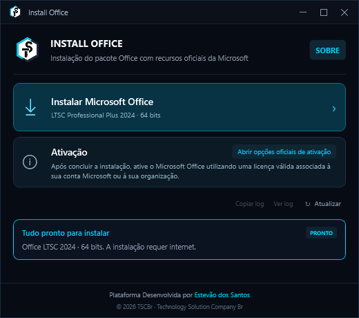
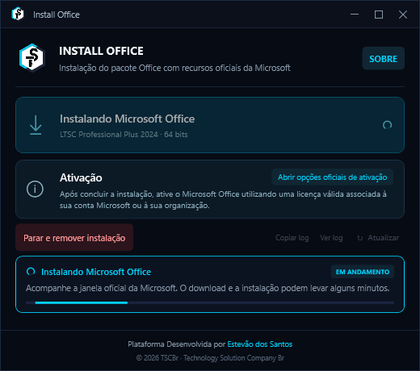
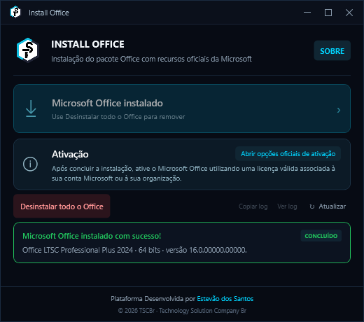

# Install Office

Ferramenta independente desenvolvida para automatizar e simplificar o processo de instalação do Microsoft Office utilizando recursos oficiais da Microsoft.



## Sobre

O Install Office automatiza etapas que normalmente precisam ser realizadas manualmente durante a preparação e instalação do Microsoft Office: criar a pasta de trabalho, obter o Office Deployment Tool, montar o XML de configuração, abrir um prompt administrativo e executar `setup.exe /configure`.

Com o aplicativo, esse procedimento vira um clique. A ferramenta organiza configuração, produto e arquitetura, executa o instalador oficial da Microsoft e confirma o resultado antes de informar sucesso.

A versão atual é a **v3**, uma reescrita completa da versão anterior em C# e WPF, com foco em confiabilidade, verificação e experiência do usuário.

## Funcionalidades

- Instalação do **Office LTSC Professional Plus 2024 (64 bits)** pelo Office Deployment Tool oficial.
- Verificação prévia do computador: permissão de administrador, Windows x64 compatível, 6 GB livres e aplicativos Office abertos.
- Detecção de Office já instalado (Click-to-Run e MSI, registro de 32 e 64 bits e instalações parciais).
- Geração da configuração de execução a partir de um XML base: idioma do Windows, formatos Office Open XML e janela oficial da Microsoft visível.
- Validação da assinatura digital do `setup.exe` (Authenticode, signatário Microsoft Corporation) antes de executá-lo.
- Confirmação real do resultado: produto, arquitetura, versão e presença de Word, Excel e PowerPoint. Código de saída zero sozinho não é tratado como sucesso.
- **Parar e remover instalação** em andamento, com remoção limitada ao produto instalado pela ferramenta.
- **Desinstalar todo o Office**, com confirmação: Click-to-Run pelo ODT e versões MSI pelo `msiexec`, usando apenas códigos de produto.
- Logs por operação, com chaves de produto mascaradas, e botões **Ver log** e **Copiar log** para suporte.
- Interface compacta em tema escuro, splash de carregamento e área **Sobre** com diagnóstico do ambiente.

## Ativação

A versão disponibilizada neste repositório **não inclui mecanismos de ativação não oficiais**.

Após a instalação, o Office deve ser ativado através de uma licença válida da Microsoft, conta Microsoft ou mecanismo de licenciamento fornecido pela organização responsável (KMS, MAK ou Active Directory). O botão **Abrir opções oficiais de ativação** apenas abre a [documentação oficial da Microsoft sobre ativação por volume](https://learn.microsoft.com/office/volume-license-activation/plan-volume-activation-of-office).

A instalação é executada com `AUTOACTIVATE=0` e o XML de configuração não contém chave de produto.

## Tecnologias

- C# e .NET 10 (`net10.0-windows`)
- WPF
- Office Deployment Tool da Microsoft (`setup.exe /configure`)
- APIs do Windows: WinVerifyTrust (assinatura Authenticode), Service Control Manager (serviço Click-to-Run) e Registro
- Windows Installer (`msiexec`) para remover versões MSI do Office
- PowerShell para os scripts de publicação e verificação
- Publicação em executável único, autossuficiente, Windows x64

## Como funciona

1. O aplicativo abre com permissão de administrador e detecta se já existe Office no computador.
2. Ao clicar em **Instalar Microsoft Office**, confere os pré-requisitos.
3. Copia os arquivos incorporados para `C:\MS OFFICE SETUP`, conferindo o SHA-256 de cada cópia.
4. Gera o XML de execução a partir de [`instalação/MS OFFICE SETUP/Configuração.xml`](instalação/MS%20OFFICE%20SETUP/Configuração.xml).
5. Valida a assinatura Microsoft do `setup.exe` e o executa com `/configure`.
6. O próprio instalador da Microsoft baixa os arquivos do Office pelos servidores oficiais.
7. Ao final, confere o produto instalado e mostra o resultado, com o log disponível.

| Instalando | Concluído |
| --- | --- |
|  |  |

## Como compilar

Requisitos: Windows 10 (1809) ou superior, x64, e SDK do .NET 10.

1. Baixe o [Office Deployment Tool](https://www.microsoft.com/download/details.aspx?id=49117) no Microsoft Download Center.
2. Execute o arquivo baixado para extrair o conteúdo e copie o `setup.exe` para `instalação/MS OFFICE SETUP/`.
   O `setup.exe` não é versionado neste repositório; a compilação avisa caso ele esteja ausente.
3. Execute a verificação e a publicação:

```powershell
.\verify.ps1
.\publish.ps1
```

O executável é gerado em `dist\win-x64\TSCBr_InstaladorOffice.exe`. Para indicar outro SDK: `.\publish.ps1 -DotnetPath 'C:\Program Files\dotnet\dotnet.exe'`.

Para usar: execute como administrador em um Windows x64 com acesso à internet. A edição LTSC Professional Plus requer licença por volume compatível.

## Testes

`verify.ps1` executa 100 verificações automatizadas sem instalar, remover ou alterar o Office da máquina. O instalador real é substituído por processos de teste inofensivos.

São cobertos: cópia e integridade dos arquivos, geração da configuração, ausência de chave de produto, assinatura real da Microsoft e rejeição de executável adulterado, argumentos com espaços e acentos, códigos de erro, cancelamento, limpeza com escopo limitado, desinstalação Click-to-Run e MSI simulada, reinicialização pendente, operações concorrentes, mascaramento de chaves nos logs e estados da interface WPF.

## Segurança

- Nenhum product key incluído.
- Nenhuma credencial armazenada.
- Nenhuma rotina de bypass de licenciamento.
- Nenhum servidor de ativação de terceiros.
- Nenhum mecanismo de ativação não autorizado.
- Nenhum script remoto executado: o aplicativo não baixa nem executa código de fontes externas.
- Execução apenas do `setup.exe` com assinatura Microsoft válida.
- Remoção MSI somente por código de produto, sem executar comandos armazenados no registro.
- Limpeza restrita aos arquivos criados pela própria operação.

## Estrutura

```text
src/TSCBr.OfficeInstaller/                 aplicativo WPF e serviços
tools/TSCBr.OfficeInstaller.Verification/  verificação automatizada
instalação/MS OFFICE SETUP/                XML base (o setup.exe é obtido da Microsoft)
docs/capturas/                             capturas de tela
docs/TERCEIROS.md                          créditos e licenças de terceiros
publish.ps1 · verify.ps1 · build.bat       publicação e verificação
```

## Histórico

- **v2** — versão anterior, em Python com CustomTkinter.
- **v3** — versão atual, reescrita em C# com WPF.

| Área | v2 | v3 |
| --- | --- | --- |
| Interface | CustomTkinter, janela fixa | WPF compacta e redimensionável, splash, área Sobre |
| Instalação | Script externo | Office Deployment Tool oficial, incorporado |
| Verificação | Somente código de saída | Assinatura, SHA-256 e confirmação do produto instalado |
| Operações | Instalar | Instalar, parar e remover, desinstalar |
| Diagnóstico | Notificação temporária | Logs por operação, estado e diagnóstico |
| Testes | Nenhum | 100 verificações automatizadas |

## Status

🟢 Em uso

## Aviso

Microsoft, Microsoft 365, Office e demais marcas mencionadas pertencem aos seus respectivos proprietários.

Este projeto é independente e não possui afiliação oficial com a Microsoft.

A versão pública limita-se à automação de processos de instalação utilizando recursos legítimos e oficiais.

## Autor

**Estevão dos Santos**  
TSCBr — Technology Solution Company

[GitHub](https://github.com/dev-estevao-miguel) · [LinkedIn](https://www.linkedin.com/in/estev%C3%A3o-miguel-a22057171/) · [Site TSCBr](https://www.tscbr.com.br/)
